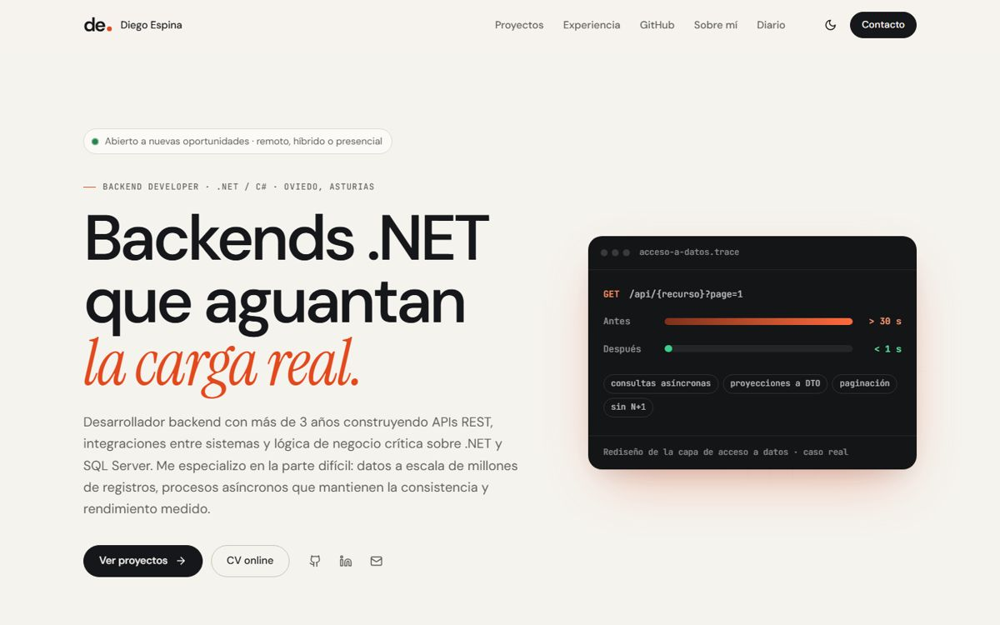
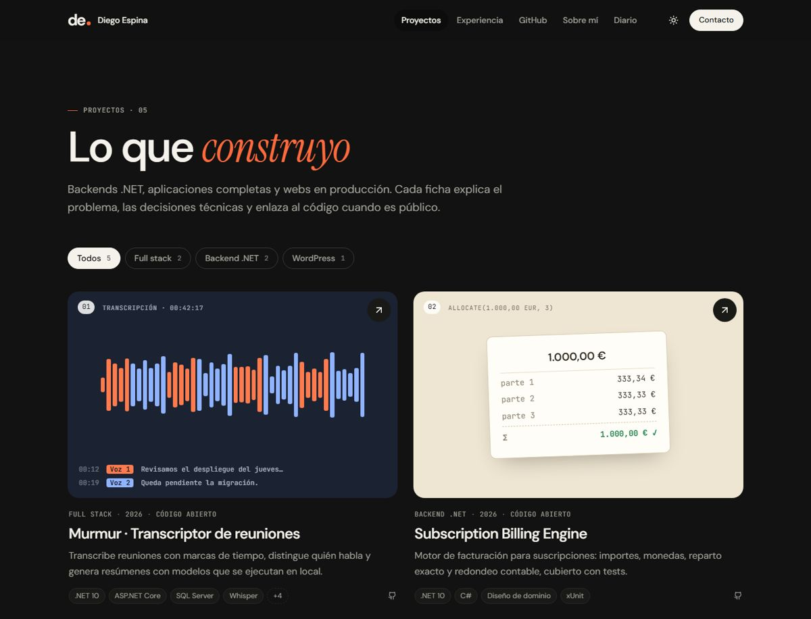

# Diego Espina · Web personal

Frontal de [diegoespinarodriguez.com](https://diegoespinarodriguez.com): porfolio, CV online y actividad en GitHub de Diego Espina Rodríguez, Backend Developer .NET. **React 19**, TypeScript y Vite, servido por Nginx. La API en ASP.NET Core 10 vive en su propio repositorio: [My-personal-Website-Back](https://github.com/diegoesp10/My-personal-Website-Back).



## Páginas

Cada sección es una ruta propia, con su título y descripción para buscadores:

| Ruta | Contenido |
| --- | --- |
| `/` | Portada: titular, retrato generativo, especialidad con el caso de rendimiento, proyectos destacados, trayectoria, stack y últimos commits. |
| `/proyectos` | Todos los proyectos con filtro por categoría (`?categoria=` se puede compartir). |
| `/proyectos/:id` | Ficha del proyecto: historia, puntos destacados, tecnologías y enlaces a la web y a los repositorios. |
| `/experiencia` | CV online: perfil, experiencia, competencias y formación. Al imprimir se convierte en un CV de una columna (Guardar como PDF). |
| `/github` | Perfil, lenguajes, commits recientes y repositorios públicos, leídos de GitHub a través de la API. Enlaza cada repositorio con su ficha. |
| `/visitas` | Mapa de visitas en directo: globo interactivo con las ciudades de origen, cifras, actividad de 30 días, países, últimas visitas, páginas más vistas y sitios de origen. |
| `/sobre-mi` | Presentación, forma de trabajar y vida fuera de la pantalla. |
| `/diario`, `/diario/:id` | Entradas del diario. |
| `/contacto` | Correo (con botón para copiar), teléfono, LinkedIn, GitHub y modalidad de trabajo. |
| `/editor` | Editor local del contenido. Solo funciona con la API en Development desde este equipo. |

## Diseño

- Paleta marfil, tinta y naranja con **modo claro y oscuro** (sigue al sistema y se puede cambiar desde la cabecera). Todos los colores son tokens en `src/styles/tokens.css`.
- Tipografías incluidas en el proyecto (sin servicios externos): DM Sans para el texto, Instrument Serif en cursiva para los acentos y JetBrains Mono para etiquetas y datos técnicos.
- Composiciones propias para los proyectos sin captura (onda de audio, libro contable, documentos…). Al subir una captura desde el editor, sustituye a la composición.
- **Retrato generativo** en la portada y en «Sobre mí»: 5.503 puntos dibujados en un canvas (`components/DotPortrait.tsx`). Se construye con una línea de escaneo la primera vez que aparece y los puntos se apartan y se tiñen de naranja alrededor del cursor. En tema claro el tamaño del punto sigue a la sombra; en oscuro, a la luz. La web solo publica `src/assets/portrait-dots.png` (un píxel por punto), nunca la foto. Para regenerarlo con otra foto: `python scripts/portrait/make_portrait.py <foto>` (Pillow, NumPy y SciPy; el recorte y la silueta del script son de la foto original).
- **Globo de visitas** (`components/Globe.tsx`), dibujado en canvas con proyección ortográfica propia: unos 5.000 puntos de tierra con brillo según la profundidad y la cara oculta en transparencia, ciudades que laten y arcos hasta Oviedo con un cometa animado. Se arrastra con inercia, gira con las flechas del teclado, rota solo en reposo, muestra los datos de cada ciudad al pasar el cursor y se orienta al pulsar un país o una visita. La tierra sale de `src/assets/land-mask.ts` (1 bit por grado), generado desde Natural Earth con `node scripts/globe/make-land-mask.mjs`. Cada página vista se envía con `sendBeacon` (`data/visits.ts`), sin cookies, y no se envía nada si el navegador pide no ser rastreado.
- **Movimiento** (`styles/motion.css`), con la View Transitions API: las páginas salen con desenfoque y entran desde abajo, la imagen de un proyecto se transforma de la tarjeta a su ficha, la píldora del menú se desliza a la sección nueva, las tarjetas se recolocan al filtrar y el cambio de tema se extiende en círculo desde el botón. Al hacer scroll, los bloques aparecen escalonados. Los navegadores sin View Transitions navegan sin animación y, con «reducir movimiento», todo se desactiva.
- **Imagen para compartir** (`public/og-image.png`, 1200×630): el retrato de puntos con el nombre y el perfil, en el tema oscuro. Es la que muestran Google, LinkedIn o WhatsApp al compartir una página sin imagen propia. Se genera desde `scripts/og/og-image.html` con `node scripts/og/make-og-image.mjs`, que necesita Google Chrome (variable `CHROME` si no está en la ruta habitual).
- Accesible: enlace para saltar al contenido, foco gestionado al cambiar de página, `aria-current` en la navegación, contraste AA y movimiento reducido respetado.
- Responsive desde 360 px, sin desplazamiento horizontal.



## Desarrollo

Requisitos: Node.js 22.12+. La API debe estar en marcha en el puerto 5080 (`Start-Api.ps1` en el repositorio del backend, carpeta hermana `Mi Web Back`).

```powershell
npm ci
npm run dev
```

Abre <http://127.0.0.1:5173>. Vite redirige `/api`, `/uploads` y `/sitemap.xml` a la API. El editor está en <http://127.0.0.1:5173/editor>.

Vista integrada en un solo proceso (compila, copia `dist/` a `Portfolio.Api/wwwroot` del backend y arranca la API en <http://127.0.0.1:5080>):

```powershell
.\scripts\Start-Portfolio.ps1            # -SkipBuild reutiliza dist/, -BackendPath otra carpeta
```

Otros comandos: `npm run build` (comprobación de tipos y compilación en `dist/`), `npm run typecheck`, `npm run format`.

## Docker

```powershell
.\Start-Docker.ps1
```

Construye la imagen y arranca el contenedor web en <http://127.0.0.1:8080> (`$env:PORTFOLIO_PORT` cambia el puerto). Si el contenedor de la API no está en marcha y el backend está en `..\Mi Web Back`, lo arranca antes con su propio script. `-SkipBuild` reutiliza las imágenes.

| Imagen | Contenedor | Red |
| --- | --- | --- |
| `diego-portfolio-web:local` | `diego-portfolio-web` | `diego-portfolio-net` (externa, compartida con la API) |

Nginx sirve `dist/` con caché inmutable para `/assets/`, `no-cache` para el HTML, compresión gzip y cabeceras de seguridad (CSP, `X-Frame-Options`, `Permissions-Policy`…) definidas en `nginx-security-headers.inc`. Inserta con SSI los metadatos de cada página (ver «SEO») y reenvía `/api/`, `/uploads/` y `/sitemap.xml` al contenedor `api`, resolviéndolo en cada petición: el contenedor web arranca aunque la API aún no esté lista. Se ejecuta sin root, con sistema de archivos de solo lectura y sin capacidades.

```powershell
docker compose ps
docker compose logs --tail 100
docker compose down
```

## SEO

Cada página llega con su título, descripción, dirección canónica, imagen para compartir y datos schema.org ya en el HTML. Los genera la API a partir del contenido (`GET /api/seo/head`) y Nginx los inserta con SSI en el `<head>` de `index.html`, en lugar del bloque de reserva. Así los leen los buscadores y las vistas previas de LinkedIn o WhatsApp, que no ejecutan JavaScript. Al navegar dentro de la web, `lib/seo.ts` pide los de la página nueva (`GET /api/seo/page`) y sustituye las etiquetas marcadas con `data-seo`. En `npm run dev` no hay SSI: la primera página también se completa desde la API. `public/robots.txt` apunta al sitemap que genera la API.

## Estructura

```text
src/
├── App.tsx                 Router de datos (necesario para las transiciones): una ruta por página
├── main.tsx                Fuentes y estilos
├── assets/                 Datos del retrato generativo
├── components/             Cabecera, pie, tarjetas, retrato, enlaces con transición, bloques comunes
├── pages/                  Una página por ruta
├── editor/                 Editor local (carga bajo demanda)
├── data/                   Contexto del contenido y consulta de GitHub
├── lib/                    Tipos del contrato de la API, metadatos SEO, formato, enlaces seguros y aparición al hacer scroll
└── styles/                 tokens, base, layout, componentes, páginas, movimiento, editor e impresión
public/                     favicon, robots.txt, og-image.png y theme-init.js (tema antes del primer pintado)
scripts/                    Vista integrada local y generadores del retrato, del mapa y de la imagen para compartir
Dockerfile · nginx.conf · compose.yaml · Start-Docker.ps1
```

`src/lib/types.ts` refleja el contrato JSON de la API; si cambia el modelo del backend hay que actualizarlo. El contrato conserva `metrics`, pero la web no muestra cifras ni el editor las edita. Las rutas públicas también figuran en el sitemap y en los metadatos SEO que genera la API. Las convenciones del repositorio están en [AGENTS.md](AGENTS.md).

## Contenido del perfil y proyectos

`profile.hasDrivingLicense` y `profile.hasOwnVehicle` son booleanos opcionales al importar contenido antiguo (por defecto `false`). Se editan desde Perfil y se muestran en Sobre mí, el CV y su versión imprimible cuando están activados. `project.experienceId` vincula el trabajo a una etapa profesional; vacío indica un proyecto personal.

El contenido incluye Azure y pipelines de CI/CD, uso diario de Claude y Codex y aprendizaje con LLMs locales. La ficha `peluqueria-lucia` describe la web pública, gestión y agenda del salón como proyecto en desarrollo; su composición decorativa utiliza `art: "salon"`. Los textos y competencias se gestionan desde el editor, no están incrustados en las páginas.

## CI/CD por SSH

El workflow `.github/workflows/ci-cd.yml` comprueba las PR y publica una imagen al actualizar `main`. El despliegue a la VM espera aprobación en el entorno `production`, usa secretos de GitHub y conserva los datos. Configuración, credenciales y activación en [docs/CI-CD.md](docs/CI-CD.md).
